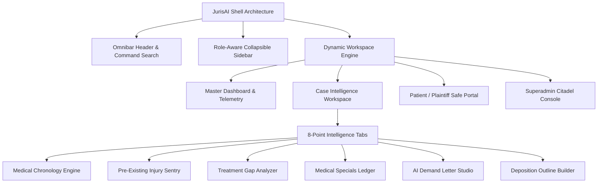

# JurisAI Platform — Design System & UI/UX Specification

<div align="center">

```
     ██╗██╗   ██╗██████╗ ██╗███████╗ █████╗ ██╗
     ██║██║   ██║██╔══██╗██║██╔════╝██╔══██╗██║
     ██║██║   ██║██████╔╝██║███████╗███████║██║
██   ██║██║   ██║██╔══██╗██║╚════██║██╔══██║██║
╚█████╔╝╚██████╔╝██║  ██║██║███████║██║  ██║██║
 ╚════╝  ╚═════╝ ╚═╝  ╚═╝╚═╝╚══════╝╚═╝  ╚═╝╚═╝
```

**Enterprise Legal Intelligence & HIPAA-Compliant Medical Chronology System**

[](#)
[](#)
[](#)
[](#)

---

</div>

## Executive Summary

The **JurisAI Design System** establishes the visual language, human interface guidelines, and front-end architectural standards for the JurisAI Legal-Tech SaaS platform. Tailored specifically for litigation attorneys, managing partners, paralegals, and plaintiffs, the platform merges **deep legal authority** with **cutting-edge AI computing**.

Every layout, token, and interactive component balances **clinical data security (HIPAA Zero-Breach Policy)**, **cognitive speed under high evidentiary load**, and **bespoke editorial elegance**.

---

## 1. Design Philosophy & Core Pillars

The user experience of JurisAI is governed by four uncompromising tenets:

```
+---------------------------------------------------------------------------------------+
|                                JURISAI DESIGN PILLARS                                 |
+---------------------------+---------------------------+-------------------------------+
|  1. CLINICAL TRUST        |  2. COGNITIVE SPEED       |  3. BESPOKE SOPHISTICATION    |
|  Strict HIPAA isolation,  |  Sub-second decisioning,  |  Deep Navy & Warm Imperial    |
|  zero-breach PHI masking, |  scannable chronology,    |  Gold; editorial typography   |
|  and verifiable telemetry.|  and multi-pane intel.    |  suited for high-stakes law.  |
+---------------------------+---------------------------+-------------------------------+
|                          4. MULTI-TENANT CITADEL                              |
|                          Air-tight firm boundaries across every view, modal,          |
|                          table, and client-facing touchpoint.                         |
+---------------------------------------------------------------------------------------+
```

### 1.1 Clinical Trust & HIPAA Fidelity
Every component handling medical records, billing data, or plaintiff testimony implements zero-leakage UI patterns. Protected Health Information (PHI) is veiled by default during screen sharing, idle states trigger animated security curtains, and audit attribution is surfaced directly in data inspection views.

### 1.2 Cognitive Speed & Low Cognitive Load
Attorneys review hundreds of pages of medical records in minutes. The UI minimizes eye travel through dense horizontal layouts, predictable 15-column dashboard grids, split-screen PDF-to-chronology alignment, and instant search accelerators.

### 1.3 Bespoke Legal Elegance
JurisAI replaces generic SaaS aesthetics with a palette inspired by classical jurisprudence and luxury legal chambers: **Deep Atlantic Navy (`#1A3757`)**, **Imperial Warm Gold (`#B49158`)**, and a **Warm Cream Ground (`#F6F5F1`)**.

---

## 2. Brand Identity & Mark Geometry

The JurisAI insignia synthesizes the classical **Scales of Justice** with **neural synaptic circuit pathways**, reflecting calibrated legal judgment augmented by artificial intelligence.

```
                   /\
                  /  \              [ BALANCED JUSTICE ]
                 /    \             Harmonized cross-beam
                /______\            representing equitable law
                |      |
             ---|------|---
            /   |      |   \
           /  (o)      (o)  \       [ NEURAL CIRCUIT NODES ]
          /    |        |    \      45-degree bus routings &
         |     |        |     |     integrated terminal pads
       ====   ====    ====   ====
        \ /    \ /     \ /    \ /
         V      V       V      V
             \              /
              \____________/
                    ||              [ PEDESTAL FOUNDATION ]
                   ====             Tiered grounding block
                  ======            engineered on 1024x1024 grid
```

### 2.1 Logo Specifications
- **Master Coordinate Space:** `1024 × 1024` vector grid.
- **Stroke Architecture:** Primary lines run at `19px` stroke width with square caps and joined bevels.
- **Clearspace:** Minimum clearance of `1X` the pedestal height (`120px` at standard scale) on all four quadrants.
- **Minimum Digital Reproduction:** `16 × 16px` (favicon), `32 × 32px` (header icon), `48 × 48px` (dock).

---

## 3. Color Architecture & Token Matrix

The color system is engineered in CSS variables under Tailwind v4 `@theme`, providing automated dark-tint harmonization and AAA-compliant contrast ratios across light and dark interfaces.

### 3.1 Primary Brand Palette

| Token Name | Hex Code | RGB | Role / Usage | Contrast on `#FFFFFF` |
|:---|:---:|:---:|:---|:---:|
| `--color-brand-navy` | `#1A3757` | `26, 55, 87` | Primary brand anchor, headers, active navigation | **10.4:1 (AAA)** |
| `--color-brand-dark` | `#12263D` | `18, 38, 61` | Canvas base, dropdowns, high-contrast text | **13.8:1 (AAA)** |
| `--color-brand-navy-light`| `#23486F`| `35, 72, 111`| Hover states, secondary action buttons | **8.1:1 (AAA)** |
| `--color-brand-gold` | `#B49158` | `180, 145, 88` | Key CTAs, badges, AI intelligence highlights | **3.2:1 (UI Accent)** |
| `--color-brand-gold-hover`| `#A07F47`| `160, 127, 71`| Pressed & hovered state for gold CTAs | **3.8:1 (UI Accent)** |
| `--color-brand-gold-light`| `#FAF7F2`| `250, 247, 242`| Highlight badge fills, notification surfaces | **1.05:1 (Surface)** |
| `--color-brand-cream`| `#F6F5F1` | `246, 245, 241`| Master viewport background, card recess | **1.1:1 (Canvas)** |

### 3.2 Harmonized Slate Scale (Infused with Navy & Cream)

```
[50]  #FAF9F6  ──  Ultra-clean subtle card fill
[100] #F6F5F1  ──  System default background canvas
[200] #E3E8EE  ──  Divider borders, tab bars, table outlines
[300] #C4D2E1  ──  Disabled borders, secondary iconography
[400] #8EA5BE  ──  Placeholder labels, subtle timestamps
[500] #627E9F  ──  Secondary body metadata, tab indicators
[600] #3E5E82  ──  Sub-headings, inactive tab copy
[700] #23486F  ──  Interactive text links, form labels
[800] #1A3757  ──  Body headers, table headers
[900] #12263D  ──  Primary headlines, critical numbers
[950] #0C1A29  ──  Deepest chrome, dark sidebars, modals
```

### 3.3 Semantic & Functional Signals

| State | Background | Border | Text | Badge Preview | Purpose |
|:---|:---:|:---:|:---:|:---|:---|
| **Success / Verified** | `#ECFDF5` | `#A7F3D0` | `#065F46` | <kbd style="background:#ECFDF5;color:#065F46;border:1px solid #A7F3D0;padding:2px 6px;border-radius:4px;">VERIFIED</kbd> | Clean records, approved demand letters |
| **Warning / Treatment Gap** | `#FFFBEB` | `#FDE68A` | `#92400E` | <kbd style="background:#FFFBEB;color:#92400E;border:1px solid #FDE68A;padding:2px 6px;border-radius:4px;">GAP DETECTED</kbd> | Missing records, 30+ day care gaps |
| **Danger / High Risk Flag** | `#FEF2F2` | `#FECACA` | `#991B1B` | <kbd style="background:#FEF2F2;color:#991B1B;border:1px solid #FECACA;padding:2px 6px;border-radius:4px;">PRE-EXISTING</kbd> | Prior injuries, defense argument vulnerabilities |
| **AI Intelligence / Pulse** | `#FAF7F2` | `#E5DCCE` | `#B49158` | <kbd style="background:#FAF7F2;color:#B49158;border:1px solid #E5DCCE;padding:2px 6px;border-radius:4px;">AI EXTRACTED</kbd> | Neural chronology & injury valuation insights |

---

## 4. Typography System & Type Scale

JurisAI standardizes on **Montserrat** as the single typographical family, leveraging its geometric precision, legible numerals, and authoritative demeanor.

```
--font-sans: var(--font-montserrat), -apple-system, BlinkMacSystemFont, "Segoe UI", Roboto, sans-serif;
```

### 4.1 Type Hierarchy

```
DISPLAY 1   ── 32px / Bold (700)      ── Leading 40px ── Track -0.02em ── Dashboard Metric Totals
HEADLINE 1  ── 24px / Semibold (600)  ── Leading 32px ── Track -0.015em ── Page Headers & Modal Titles
HEADLINE 2  ── 18px / Semibold (600)  ── Leading 26px ── Track -0.01em ── Card Titles, Drawer Headers
SUB-HEAD    ── 15px / Medium (500)    ── Leading 22px ── Track 0.00em  ── Table Column Headers, Tabs
BODY        ── 14px / Regular (400)   ── Leading 20px ── Track +0.005em ── General Narrative & Chronology
BODY BOLD   ── 14px / Semibold (600)  ── Leading 20px ── Track +0.005em ── Case Names, Financial Amounts
CAPTION     ── 12px / Medium (500)    ── Leading 16px ── Track +0.01em ── Timestamps, Badges, Micro-copy
CODE/MONO   ── 12px / Regular (400)   ── Leading 18px ── Track 0.00em  ── ICD-10 Codes, CPT Billing, IDs
```

### 4.2 Typographic Rules
1. **Financial Precision:** Currency valuations (`$1,450,000.00`) are rendered in `font-semibold` or `font-bold` with tabular lining numbers to ensure vertical column alignment.
2. **Medical & Legal Citations:** Provider names, ICD-10 diagnosis codes, and deposition line citations are tagged with distinct muted backgrounds (`bg-slate-100 text-slate-800 text-xs px-2 py-0.5 rounded`).
3. **No Decorative Serifs:** High-density case files reject ornamental serif fonts to prevent eye strain during 8-hour chronology reviews.

---

## 5. Spatial Architecture & Layout Grid

The interface adheres to an **8-point harmonic spatial grid** (`4px`, `8px`, `12px`, `16px`, `24px`, `32px`, `48px`, `64px`).

### 5.1 Responsive Breakpoint System

```
+---------------------------------------------------------------------------------------+
|  MOBILE (<768px)          ── Single column stacked flow, sliding drawers, off-canvas  |
|  TABLET (768px - 1100px)  ── Collapsed rail navigation (64px), 2-column cards         |
|  DESKTOP (1101px - 1366px)── 2-column responsive grid layout                         |
|  EXPANDED (1367px - 1599px)─ 15-column proportional dashboard layout                  |
|  ULTRA-WIDE (>=1600px)    ── 15-column wide-canvas + 6-column metric card matrix      |
+---------------------------------------------------------------------------------------+
```

### 5.2 The 15-Column Master Dashboard Grid

To balance high-density operational telemetry with analytical charts, JurisAI employs a proprietary **15-column CSS grid engine**:

```
+---------------------------------------------------------------------------------------+
|                                15-COLUMN MASTER CANVAS                                |
+---------------------------------------------+-----------------------------------------+
|                  COLUMNS 1 to 6             |             COLUMNS 7 to 15             |
|                 (Span 6 / 40.0%)            |             (Span 9 / 60.0%)            |
+---------------------------------------------+-----------------------------------------+
|  PRIORITY TASKS BLOCK                       |  AI PROCESSING QUEUE & INGESTION        |
|  - Urgent Statute of Limitations            |  - Active OCR & NLP Extraction Jobs     |
|  - Pending Attorney Approvals               |  - Real-time Stage Progression Bars     |
|  - Overdue HIPAA Record Authorizations      |  - Cloud Lambda Worker Heartbeats       |
+---------------------------------------------+-----------------------------------------+
|  CASE STATUS DONUT BREAKDOWN                |  SETTLEMENT RECOVERY VELOCITY LINE      |
|  - Pre-Litigation vs Active vs Trial        |  - 12-month Rolling Recovery Metrics    |
|  - Intake Velocity Metrics                  |  - Historical Firm Win/Settlement Rates |
+---------------------------------------------+-----------------------------------------+
```

```css
/* Implementation Blueprint (from src/app/globals.css) */
.master-dashboard-grid {
  display: grid;
  grid-template-columns: 1fr;
  gap: 16px;
}
@media (min-width: 1367px) {
  .master-dashboard-grid {
    grid-template-columns: repeat(15, minmax(0, 1fr));
  }
  .grid-item-priority { grid-column: span 6; order: 1; }
  .grid-item-queue    { grid-column: span 9; order: 2; }
  .grid-item-line     { grid-column: span 9; order: 3; }
  .grid-item-donut    { grid-column: span 6; order: 4; }
}
```

---

## 6. Component Architecture & UI Patterns



### 6.1 Top Navigation & Omnibar Header
- **Universal Command Search:** Debounced multi-index search scanning Cases, Plaintiffs, ICD-10 entries, Audit Trails, and System Settings.
- **Role-Aware Quick Ingestion:** Dedicated `+ New Case` and `Upload Records` triggers restricted to authorized personnel (`PARALEGAL`, `ATTORNEY`, `MANAGING_PARTNER`).
- **Telemetry Indicators:** Active connection health, live notification bell with unread pulse counter, and quick-toggle Fullscreen Focus Mode.

### 6.2 Collapsible Navigation Rail
- **States:** Collapsed (`64px` icon rail with floating tooltips) and Expanded (`240px` full text with hierarchy groupings).
- **Firm Branding Integration:** Displays law firm moniker, user role pill (`MANAGING_PARTNER`, `ATTORNEY`, etc.), and secure logout handler.
- **Client Portal Mode:** When accessed by a `PLAINTIFF`, navigation automatically reduces to: *My Case*, *Treatment Timeline*, *My Documents*, and *HIPAA Authorizations*.

### 6.3 The Case Intelligence Workspace
The core work surface is structured in a split-screen operational model:

```
+---------------------------------------------------------------------------------------+
|  CASE INTELLIGENCE WORKSPACE                                                          |
+-------------------------------------------------------------------+-------------------+
|  TAB NAVIGATION BAR                                               |  CASE SUMMARY     |
|  [Chronology] [Flags] [Summary] [Gaps] [Bills] [Demand] [Depo]    |  DRAWER / PANE    |
+-------------------------------------------------------------------+-------------------+
|  PRIMARY WORKING SURFACE                                          |  - Plaintiff Bio  |
|                                                                   |  - Injury Index   |
|  • Medical Chronology Records (Grouped by Date / Encounter)       |  - Policy Limits  |
|  • Interactive PDF Anchor Links with Page Highlighting           |  - Defense Counsel|
|  • Extracted Provider, Diagnosis, Treatment, and Billing Codes    |  - Total Specials |
|  • Pre-Existing Condition Contradiction Alerts                    |  - Case Valuation |
|                                                                   |                   |
+-------------------------------------------------------------------+-------------------+
```

---

## 7. Interactive Tab Ecosystem

The Case Detail suite features 8 specialized sub-modules:

| Tab Icon | Module Name | Primary Objective | Key UI Patterns |
|:---:|:---|:---|:---|
| <Activity /> | **Medical Chronology** | Chronological record of all clinical encounters | Date-pill timeline, Provider tags, PDF deep-link icons |
| <Flag /> | **Pre-Existing Flags** | Isolates prior injuries vulnerable to defense claims | Amber high-contrast warning badges, comparison diffs |
| <Sparkles /> | **Executive Summary** | AI narrative summary of case merits and liability | Rich prose with expandable source citation pills |
| <FileQuestion /> | **Treatment Gaps** | Detects 30+ day lapses in clinical care | Interrupted timeline connectors, days-elapsed counter |
| <Folder /> | **Case Documents** | Repository of all ingested medical and legal files | Drag-and-drop dropzone, S3 presigned viewer links |
| <Handshake /> | **Settlement Valuation** | Algorithmic injury multiplier and payout models | Financial slider widgets, low/expected/high brackets |
| <Mail /> | **Demand Letter** | Auto-drafted comprehensive demand package | Split-screen Markdown editor with one-click Word/PDF export |
| <UserCheck /> | **Deposition Outline** | Strategic cross-examination examination questions | Checklist trees, cross-reference tags to chronology events |

---

## 8. Client Portal UI (Plaintiff Experience)

Designed for injured clients who may experience cognitive fatigue or emotional stress.

```
+---------------------------------------------------------------------------------------+
|  PATIENT PORTAL EMBEDDED ERGONOMICS                                                   |
+---------------------------------------------------------------------------------------+
|  1. Softened Tones: Gentle cream and teal hues instead of high-stress red alerts.     |
|  2. Plain-English Progress: "Records Requested" -> "Records Under Review"             |
|     -> "Demand Submitted" -> "In Settlement Negotiation".                             |
|  3. Frictionless E-Sign: One-click mobile-friendly HIPAA disclosure signatures.       |
|  4. Mobile Phone Capture: Direct camera upload for medical prescriptions & receipts.  |
+---------------------------------------------------------------------------------------+
```

### 8.1 Key Plaintiff Components
- **`CaseStatusCard.tsx`:** Clear progress bar indicating the active litigation phase without confusing legal jargon.
- **`HIPAAAuthorizationCard.tsx`:** Digital signature canvas with verified audit timestamp and instant download copy.
- **`PortalDocumentUpload.tsx`:** Camera-enabled file uploader with thumbnail verification and OCR status feedback.

---

## 9. HIPAA Compliance & Security UX Patterns

```
+---------------------------------------------------------------------------------------+
|                         HIPAA SECURITY INTERFACE CONTROLS                             |
+---------------------------------------------------------------------------------------+
|  [ PRIVACY CURTAIN ]        [ IDLE TIMEOUT SENTINEL ]      [ FIRM DATA PERIMETER ]    |
|  One-click keyboard         Automated 15-minute            Every query, mutation,     |
|  shortcut masks all names,  inactivity detector displays   and view verifies firmId   |
|  dates, and SSNs for        a 60-second warning countdown  at the database layer. No  |
|  safe screen-sharing.       before clearing session JWT.   cross-firm visibility.     |
+---------------------------------------------------------------------------------------+
```

### 9.1 Technical Security Specifications
1. **Zero Stack Traces in Production:** Component error boundaries intercept crashes and present sanitized, friendly guidance (`src/components/LockedModuleOverlay.tsx`).
2. **Deterministic Audit Logging:** Every document download, chronology export, and case modification generates an immutable log entry stored with IP, actor, role, and timestamp (`/api/audit-logs`).
3. **Storage Security:** All uploaded files are encrypted with AWS KMS customer-managed keys and served via time-bounded (15-minute) S3 presigned URLs.

---

## 10. Motion, Transitions & Micro-Interactions

Animations are strictly purposeful—designed to confirm actions, clarify spatial continuity, and communicate real-time AI background computation.

### 10.1 Keyframe Inventory

```css
/* Floating AI Indicator */
@keyframes float {
  0%, 100% { transform: translateY(0); }
  50% { transform: translateY(-15px); }
}

/* Page & Drawer Ingress */
@keyframes fade-in-up {
  from { opacity: 0; transform: translateY(20px); }
  to { opacity: 1; transform: translateY(0); }
}

/* Slide Drawer */
@keyframes slide-in-right {
  from { transform: translateX(100%); }
  to { transform: translateX(0); }
}

/* AI Status Pulsing Ring */
@keyframes pulse-subtle {
  0%, 100% { opacity: 1; }
  50% { opacity: 0.5; }
}
```

### 10.2 Unified Scrollbar Design
To maintain a clean editorial feel in deep data tables:
- **Width / Height:** `6px` unified profile.
- **Track:** Transparent.
- **Thumb:** Subdued Navy `rgba(26, 55, 87, 0.15)` with `9999px` rounded pill.
- **Hover:** Imperial Warm Gold `rgba(180, 145, 88, 0.45)` for subtle user feedback.

---

## 11. Component File Structure

```
src/components/
├── cases/
│   ├── CaseApprovalButtons.tsx      # Managing Partner sign-off actions
│   ├── CaseDetailsDrawer.tsx        # Slide-over case metadata pane
│   ├── CaseDetailsForm.tsx          # Case creation and edit validation
│   ├── CasesTable.tsx               # Primary high-density data table
│   ├── CloseCaseButton.tsx          # Multi-step archival trigger
│   ├── DeleteCaseModal.tsx          # Strict confirmation deletion modal
│   ├── DocumentUploadArea.tsx       # Drag-and-drop secure file ingest
│   ├── ExportDropdown.tsx           # PDF, Word, and Excel export suite
│   └── UploadDocumentButton.tsx     # Floating upload trigger
├── dashboard/
│   ├── AdvancedMetrics.tsx          # Firm revenue & velocity stats
│   ├── AIProcessingQueue.tsx        # Real-time Lambda worker monitor
│   ├── AttorneyMetrics.tsx          # Caseload breakdown per attorney
│   ├── ManagingPartnerMetrics.tsx   # Executive firm telemetry
│   ├── PriorityTasks.tsx            # Solved & pending litigation items
│   └── TopPerformers.tsx            # Paralegal & attorney throughput
├── modals/
│   ├── CaseSummaryDrawer.tsx        # Fast-peek AI case summary
│   └── CloseCaseModal.tsx           # Reason-documented closure flow
├── portal/
│   ├── CaseStatusCard.tsx           # Plain-English case progression
│   ├── HIPAAAuthorizationCard.tsx   # E-signature authorization card
│   ├── PortalDashboard.tsx          # Plaintiff command center
│   ├── PortalDocumentRequests.tsx   # Outstanding requests from firm
│   ├── PortalDocumentUpload.tsx     # Plaintiff mobile-friendly uploader
│   ├── PortalHeader.tsx             # Simplified patient header
│   ├── PortalMyDocuments.tsx        # Uploaded records list
│   ├── PortalProfileSettings.tsx    # Plaintiff contact verification
│   ├── PortalTabs.tsx               # Portal navigation bar
│   └── PortalUpdates.tsx            # Chronological case milestone updates
├── timeline/
│   ├── CaseDocumentsTab.tsx         # Document viewer & category filter
│   ├── CaseIntelligenceBlock.tsx    # Quick AI metrics right-rail block
│   ├── CaseValuationTab.tsx         # Settlement bracket calculator
│   ├── ChronologyTab.tsx            # Chronological medical index
│   ├── CrossModulePhotosShowcase.tsx# Injury & property damage gallery
│   ├── DamagesTab.tsx               # General and special damages ledger
│   ├── DemandLetterTab.tsx          # Automated demand letter writer
│   ├── DepositionOutlineTab.tsx     # Examination question builder
│   ├── DepositionTab.tsx            # Deposition transcript navigator
│   ├── FlagsTab.tsx                 # Pre-existing condition sentry
│   ├── GapsTab.tsx                  # Treatment lapse detector
│   ├── MedicalBillsTab.tsx          # Itemized medical billing ledger
│   ├── NegotiationTab.tsx           # Settlement counter-offer tracker
│   ├── NetworkTab.tsx               # Provider & insurer directory
│   ├── PropertyDamageTab.tsx        # Vehicle & structural damage review
│   ├── RightSidebar.tsx             # Collapsible intelligence right rail
│   └── SummaryTab.tsx               # Executive case summary tab
├── ui/
│   └── CustomDatePicker.tsx         # Accessible date selector
├── users/
│   ├── DeleteUserModal.tsx          # User de-provisioning confirmation
│   └── UserFormModal.tsx            # Staff role assignment & setup
├── DashboardCharts.tsx              # Analytics chart wrapper
├── DashboardChartsClient.tsx        # Recharts client-side renderer
├── FirstLoginModal.tsx              # Force password reset & 2FA modal
├── GiveFeedbackModal.tsx            # In-app feedback & bug reporting
├── Header.tsx                       # Global omnibar & role switcher
├── IdleTimeoutProvider.tsx          # Automated 15-min HIPAA logout guard
├── LockedModuleOverlay.tsx          # RBAC subscription paywall / lock
├── Sidebar.tsx                      # Collapsible navigation rail
├── SuperadminSidebar.tsx            # Multi-firm control navigation
└── ViewSummaryButton.tsx            # Summary drawer quick trigger
```

---

## 12. Quality Assurance & Design Checklists

Before releasing any new interface component or screen, verify compliance against the following gate:

- [ ] **Firm Isolation:** Query / Mutation includes explicit `firmId` scoping.
- [ ] **HIPAA PHI Protection:** No unmasked patient identifiers in logs, toasts, or public endpoints.
- [ ] **Responsive Integrity:** Tested across `375px` (Mobile), `1024px` (Tablet), `1440px` (Desktop), and `1920px` (Widescreen).
- [ ] **WCAG 2.1 AAA:** Contrast ratio meets minimum `7.0:1` for normal text and `4.5:1` for bold / large text.
- [ ] **Keyboard Navigation:** Fully navigable via `Tab`, `Shift+Tab`, `Enter`, `Space`, and `Esc`.
- [ ] **No Dead Code:** All unused imports, commented debug snippets, and unreferenced tokens removed.
- [ ] **Performance:** Zero layout shifts (`CLS < 0.1`), sub-second time to interactive (`TTI < 1.0s`).

---

<div align="center">

**JurisAI Design System • Confidential & Proprietary Legal Technology**  
*Maintained by the JurisAI Core Architecture & Product Engineering Team*

</div>

